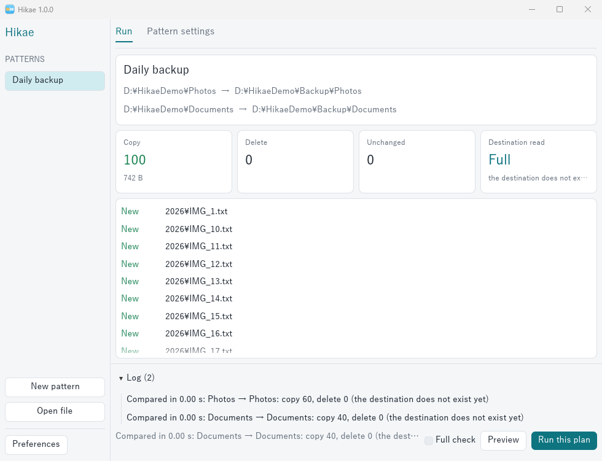
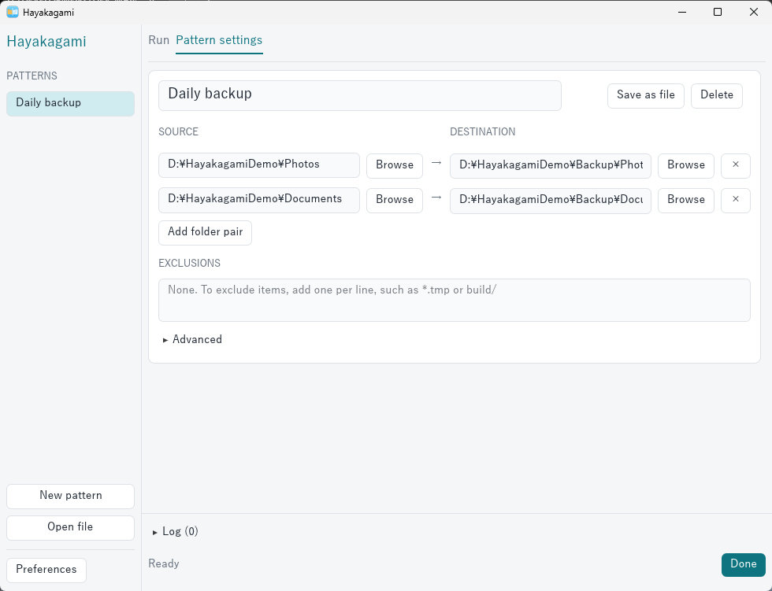

<p align="center"></p>

# Hayakagami

[](https://github.com/HiroYokoyama/hayakagami/actions/workflows/build.yml)
[](https://github.com/HiroYokoyama/hayakagami/releases/latest)


English | [日本語](README_JA.md)

A folder-based mirror backup tool for Windows, macOS and Linux.

It is built for the common case where almost nothing changed, yet a backup still spends its time scanning.

> **Warning:** a mirror deletes files from the destination when they are gone from the source. The first time you use a folder, check the plan with **Preview** (`--dry-run` on the command line).





## Install

Download the archive for your system from [Releases](https://github.com/HiroYokoyama/hayakagami/releases/latest) and unpack it anywhere. There is no installer. It holds `hayakagami-gui` (the desktop app) and `hayakagami` (the command line).

The programs are not signed, so Windows and macOS may warn when you first open them.

## Why it is fast

- **It skips the destination.** The state of the destination is remembered after each run, so the next run only reads the source.
- **It lists folders in bulk.** On Windows, sizes and dates come from one listing per folder, without opening each file.
- **It adapts to the disk.** Hard disks get few threads, while SSDs and network shares get more. A disk that cannot be identified is treated as a hard disk.

## Benchmark

Time to compare 100,000 files in 2,000 folders when nothing changed, in seconds. Each figure is the median of 5 runs on a GitHub Actions runner, with the file cache warm.

| | Windows | macOS | Linux |
|---|---:|---:|---:|
| Hayakagami, saved state | 0.178 | 0.213 | 0.182 |
| Hayakagami, saved state and `--usn` | 0.198 | - | - |
| Hayakagami, `--full` | 0.261 | 1.083 | 0.219 |
| robocopy `/MIR /L` | 0.416 | - | - |
| rsync `-a --delete --dry-run` | - | 6.231 | 0.781 |

With the file cache empty, which is possible only on the Linux runner, the saved state took 0.638 s, `--full` 0.741 s and rsync 2.493 s.

These runners have fast disks and a warm cache, so the time a hard disk spends seeking does not appear here, and the change journal shows no gain. Results on your own disks will differ. To repeat this, run the `Benchmark` workflow.

## The NTFS change journal (optional)

On Windows, turn on **Use the NTFS change journal** under **Advanced** (`--usn` on the command line) to skip the source folders that did not change. It is off by default.

- Most drives need administrator rights to read the journal. Windows asks for permission once per window: when a pattern file is opened, or at the first preview or run otherwise. The rights are used only to read the journal, by a small helper process. Copying and deleting never run with them.
- If you decline, or on the command line without those rights, the source is listed as usual.
- The source is also listed as usual when the journal was recreated, no longer reaches back to the last run, or names too many changed folders, and at every full check.
- Changes made while the drive was attached to another operating system may not be recorded. Run a full check after that.
- Volumes without a journal are not set up for you yet.

## When the saved state is not trusted

Hayakagami reads the whole destination (a full check) when:

- the destination disk changed
- the last run did not finish
- `.hayakagami-state` in the destination is missing or does not match
- the periodic full check is due (every 30 days by default)
- you ask for a full check

While the saved state is in use, **changes made by hand in the destination go unnoticed**. Run a full check after editing the destination yourself.

## How your data is protected

Hayakagami stops without changing anything, and asks you to review the plan, when:

- the source is empty but files would be deleted (a disconnected drive, for example)
- files would be deleted from a destination it has never mirrored to (the wrong folder, for example)
- existing files would be overwritten in a destination it has never mirrored to
- half or more of the destination's files would be deleted (when it holds 10 files or more)
- a tenth or more of the destination's files would be overwritten (when it holds 10 files or more), as ransomware in the source would cause

It also behaves as follows:

- Overlapping source and destination folders are refused.
- A folder that cannot be read is left alone: nothing in it is copied or deleted.
- Symbolic links and junctions are never followed. By default they are not copied either (see [Links](#links)).
- Excluded files are not deleted from the destination.
- Files are copied to a temporary name, forced onto the disk and then swapped in, so an interruption or power cut does not damage the existing copy. This makes copying many small files slower.

## Usage

### Desktop app

Start `hayakagami-gui` and create a pattern. A pattern is a named set of folder pairs and exclusions. Choose the language under **Preferences**.

1. Press **New pattern**, then choose the source and destination folders under **Pattern settings**.
2. On the **Run** tab, press **Preview** to review the plan.
3. Press **Run this plan**, or **Run** to skip the preview.

### Pattern files

**Save as file** stores a pattern as a `.hkgm` file. On the command line, use `hayakagami run <file>.hkgm`.

On Windows, press **Link .hkgm files** under **Preferences** to open these files with a double-click. Opening a file runs a preview. Turn on **Run right away when this pattern's file is opened** under **Advanced** to run it instead. Safety checks still apply.

Double-click opening is not available on macOS yet.

> Check a `.hkgm` file from someone else before opening it. It is plain text.

### Command line

```bash
hayakagami run <pattern name>
```

```bash
hayakagami mirror <source> <destination> --exclude "*.tmp" --dry-run
```

| Option | Meaning |
|---|---|
| `--dry-run` | Compare only and change nothing |
| `--full` | Read the destination from disk instead of the saved state |
| `--allow-delete` | Carry out changes that a safety check stopped |
| `--copy-links` | Recreate links in the destination |
| `--usn` | Use the NTFS change journal (Windows) |
| `--scan-threads N` / `--copy-threads N` | Set the number of threads |
| `--lang ja` | Choose the message language |
| `-v` | List every change |

Exit codes: 0 for success, 1 when stopped, 2 when some items failed.

### Exclusion patterns

New patterns have no exclusions.

| Example | Meaning |
|---|---|
| `*.tmp` | Matching names at any depth |
| `node_modules` | This name at any depth |
| `build/` | Folders with this name only |
| `docs/draft` | A path relative to the mirrored folder |

Matching ignores case.

## Metadata

These are kept in step with the source. When only they differ, nothing is copied: the metadata alone is updated.

- Read-only, hidden and system attributes, and creation times (Windows)
- Permission bits (macOS and Linux)
- Folder modification times, except for the mirrored folder itself

A change made by hand in the destination is noticed at the next full check. On macOS and Linux, a destination folder always stays writable by its owner, so later runs can write into it.

## How files are compared

Files are compared by size and modification time, not by content. On Windows, times must match exactly on NTFS and ReFS destinations, and may differ by up to 2 seconds elsewhere. On macOS and Linux they may always differ by up to 2 seconds.

## Links

Turn on **Copy links as links** under **Advanced** (`--copy-links` on the command line) to recreate symbolic links and junctions in the destination, as a disk copy would. It is off by default.

- The target is kept exactly as it is. An absolute link in the destination still points to the original place.
- What a link points to is not copied, unless it is also inside the mirrored folder.
- On Windows, symbolic links need Developer Mode or administrator rights. Without them, or on a disk that cannot hold links such as exFAT, the link is skipped with a message. Junctions need no special rights.

## Current limitations

- A change that keeps both the size and the modification time is not detected.
- A rename that only changes letter case is not applied to the destination on Windows and macOS.
- Access control lists are not copied. Extended attributes are not copied on macOS and Linux.
- The source is read on every run, unless the change journal is in use.

## Building

```bash
cargo build --release
```

Linux needs `libgtk-3-dev`, `libxkbcommon-dev` and `libgl1-mesa-dev`.

## Scripts

- `scripts/bench.py` measures speed. Run it through the `Benchmark` GitHub Actions workflow.
- `scripts/make_icon.py` generates the icons in `assets/` (requires Pillow).
- `scripts/third_party_notices.py` collects the licenses of the crates for release archives.

## License

Copyright (C) 2026 HiroYokoyama

Hayakagami is free software under the GNU Lesser General Public License, version 3 or (at your option) any later version. See [LICENSE](LICENSE) and [COPYING](COPYING). It comes with no warranty, as those licenses state.

Release archives list the licenses of the crates built into the programs in `THIRD-PARTY-NOTICES.txt`.
