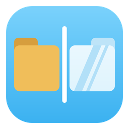
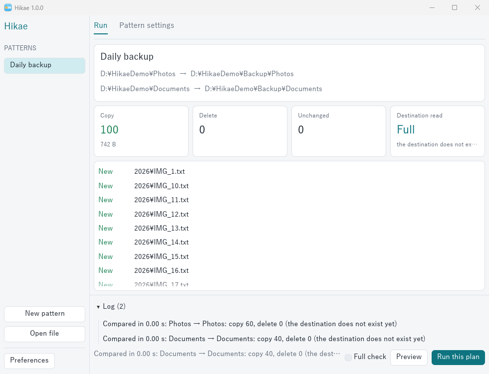
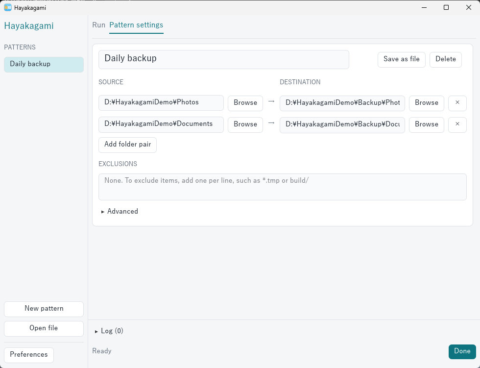

<p align="center"></p>

# Hayakagami(早鏡)

[](https://github.com/HiroYokoyama/hayakagami/actions/workflows/build.yml)
[](https://github.com/HiroYokoyama/hayakagami/releases/latest)


[English](README.md) | 日本語

フォルダ単位のミラーバックアップソフトです。Windows、macOS、Linuxで動きます。

変更がほとんどないのにスキャンで待たされる、という場面を速くすることを目標にしています。

> **ご注意:** ミラーは、元にないファイルを保存先から削除します。初めて使うフォルダでは、必ず「プレビュー」(CLIは `--dry-run`)で内容を確認してください。





## 速さの仕組み

- **保存先を読まない:** 前回の保存先の状態を手元に記録し、次回は元フォルダだけを読んで比較します。
- **一覧をまとめて取得:** Windowsではファイルを1つずつ開かず、フォルダ単位でサイズと更新日時を取得します。
- **ディスクに合わせて並列数を調整:** HDDは少なく、SSDとネットワークは多くします。種類を判定できないディスクはHDDとして扱います。

## 記録が信用できないとき

次の場合は記録を使わず、保存先も全部読みます(フルチェック)。

- 保存先のディスクが前回と異なる
- 前回の実行が途中で終わった
- 保存先の `.hayakagami-state` がない、または内容が一致しない
- 定期フルチェックの時期になった(標準は30日)
- フルチェックを指定した

記録を使っている間は、**保存先を手で変更しても気づきません**。保存先のファイルを手で消した場合などは、フルチェックで実行してください。

## データを守る仕組み

次の場合は何も変更せずに止まり、内容の確認を求めます。

- 元フォルダが空なのに、保存先に削除対象がある(ドライブの接続ミスなど)
- Hayakagamiでミラーしたことがない保存先に、削除対象がある(保存先の選び間違いなど)
- Hayakagamiでミラーしたことがない保存先で、既存のファイルを上書きしようとしている
- 保存先のファイルの半分以上を削除しようとしている(保存先に10ファイル以上ある場合)

このほか、次のように動きます。

- 元と保存先が重なっている場合は実行しません。
- 読み取れなかったフォルダの中は、削除もコピーもしません。
- シンボリックリンクとジャンクションはたどりません。
- 除外したファイルは、保存先にあっても削除しません。
- コピーは一時ファイルに書いてから置き換えるので、途中で止まっても元のファイルは壊れません。

## 使い方

### GUI

`hayakagami-gui` を起動して、パターンを作成します。パターンには、名前付きで複数のフォルダの組と除外設定を保存できます。表示言語は「環境設定」で切り替えられます。

1. 「新規パターン」を押し、「パターン設定」で元と保存先のフォルダを指定します。
2. 「実行」タブの「プレビュー」で内容を確認します。
3. 「この内容で実行」を押します。プレビューを省くときは「実行」を押します。

### パターンファイル

「ファイルに保存」で、パターンを `.hkgm` ファイルにできます。CLIでは `hayakagami run <ファイル>.hkgm` で実行できます。

Windowsでは、「環境設定」の「.hkgm を関連付け」を押すと、ダブルクリックで開けるようになります。開くとプレビューまで行います。詳細設定の「パターンファイルを開いたらすぐ実行する」をオンにすると、そのまま実行します。その場合も安全装置は働きます。

macOSではまだダブルクリックに対応していません。

> 人から受け取った `.hkgm` は、開く前に内容を確認してください。中身はテキストです。

### CLI

```bash
hayakagami run <パターン名>
```

```bash
hayakagami mirror <元フォルダ> <保存先フォルダ> --exclude "*.tmp" --dry-run
```

| オプション | 内容 |
|---|---|
| `--dry-run` | 比較だけ行い、何も変更しない |
| `--full` | 記録を使わず、保存先も全部読む |
| `--allow-delete` | 安全装置が止めた削除も実行する |
| `--scan-threads N` / `--copy-threads N` | 並列数を指定する |
| `--lang ja` | メッセージの言語を指定する |
| `-v` | 変更内容を1件ずつ表示する |

終了コードは、0が成功、1が中止、2が一部エラーありです。

### 除外パターン

| 例 | 意味 |
|---|---|
| `*.tmp` | どの階層でも、名前が一致するものを除外 |
| `node_modules` | どの階層でも、この名前を除外 |
| `build/` | この名前のフォルダだけを除外 |
| `docs/draft` | 元フォルダからの相対パスで除外 |

大文字と小文字は区別しません。

## 比較の基準

サイズと更新日時を比較します。ファイルの中身までは比較しません。Windowsでは、NTFSとReFSの保存先は日時が完全に一致したときだけ同じとみなし、それ以外は2秒以内の差を同じとみなします。macOSとLinuxでは常に2秒以内の差を同じとみなします。

## 現在の制限

- 変更内容が同じサイズで、更新日時も変わらないファイルは検出できません。
- 大文字と小文字だけの名前変更は、保存先に反映されません(Windows、macOS)。
- フォルダ自体の更新日時と、アクセス権(ACL)はコピーしません。macOSとLinuxでは拡張属性もコピーしません。
- 元フォルダは毎回読みます。

## ビルド

```bash
cargo build --release
```

Linuxでは `libgtk-3-dev`、`libxkbcommon-dev`、`libgl1-mesa-dev` が必要です。

## スクリプト

- `scripts/bench.py`: 速度を測定します。GitHub Actionsの `Benchmark` ワークフローから実行します。
- `scripts/make_icon.py`: `assets/` のアイコンを生成します(Pillowが必要)。
